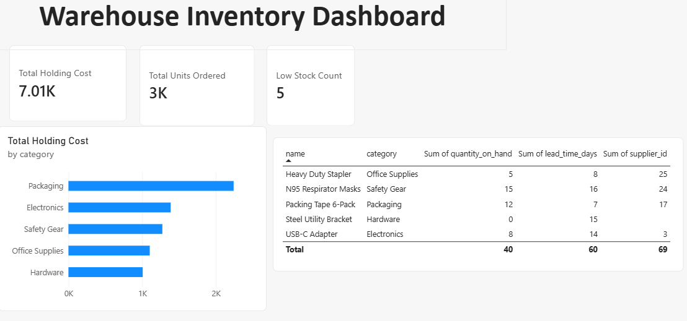
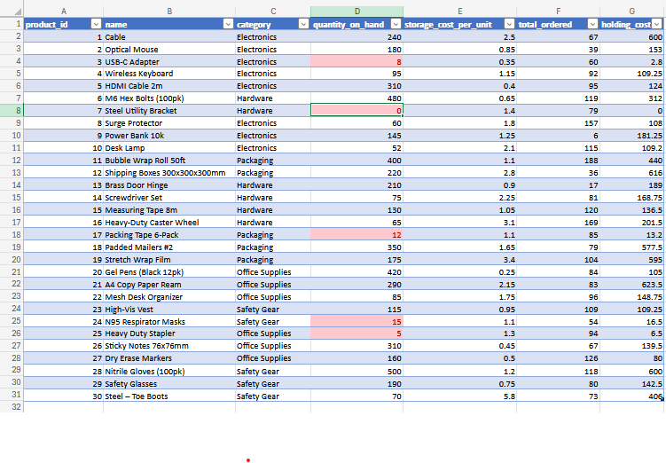
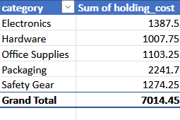
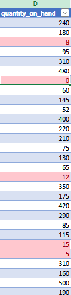

# Warehouse Inventory Analytics

An end-to-end mini analytics project that follows a small warehouse's data from raw CSV files to a finished dashboard: **CSV → SQLite → SQL cleaning → Excel → Power BI**.

The dataset is synthetic. I built it by hand and deliberately made it messy, so the project shows real data-cleaning decisions rather than a tidy toy dataset.

## The business question

Which products are running low, what is stock costing us to store, and where are we exposed if a supplier is slow or missing?

## Dashboard



## Key findings

- **Total holding cost is 7,014.45**, and **Packaging is the most expensive category at 2,241.70** (about 32% of the total).
- **5 products are below 20 units**, one from each category: USB-C Adapter (8), Steel Utility Bracket (0), Packing Tape 6-Pack (12), N95 Respirator Masks (15) and Heavy Duty Stapler (5).
- **Steel Utility Bracket is the biggest risk.** It is out of stock, 79 units were ordered, and it has **no supplier on file**.
- **Best seller:** Bubble Wrap Roll 50ft with 188 units ordered. **Slowest:** Power Bank 10k with only 6 units ordered against 145 in stock, so it is tying up storage cost for very little demand.
- 2,692 units were ordered across 200 orders.

## Tools used

| Tool | Used for |
|---|---|
| LibreOffice Calc | Building the 4 source tables by hand, with `RANDBETWEEN` formulas to generate the orders |
| Python (`sqlite3`, `csv`) | Loading the CSVs into a SQLite database |
| SQLite + SQL | Cleaning, joining and summarising the data |
| VS Code + SQLTools | Writing and running the SQL |
| Excel Online | PivotTable, calculated column and conditional formatting |
| Power BI Desktop | Data model, DAX measures and the dashboard |
| Git / GitHub | Version control and publishing |

## Project structure

```
warehouse_inventory_analysis/
├── data/                  source CSVs, exported CSVs and inventory.db
├── excel/                 inventory_summary.xlsx
├── powerbi/               warehouse_dashboard.pbix
├── screenshots/           images used in this README
├── load_products.py       Python scripts that load each CSV into SQLite
├── load_inventory.py
├── load_suppliers.py
├── load_orders.py
├── 01_cleaning.sql        deduplication and data fixes
├── 02_analysis_queries.sql
├── 03_excel_summary.sql   query behind the Excel summary
└── 03_reorder_logic.sql   query behind the Power BI reorder table
```

## Data model

| Table | Columns | Rows |
|---|---|---|
| `products` | product_id, name, category, storage_cost_per_unit | 30 |
| `inventory` | product_id, quantity_on_hand | 30 |
| `suppliers` | supplier_id, product_id, lead_time_days | 30 |
| `orders` | order_id, product_id, quantity_ordered, order_date | 200 after cleaning |

## Data quality: the mess I built in, and how I handled it

| Problem | How I handled it |
|---|---|
| **Duplicate orders** (4 copies added) | Removed with `GROUP BY` plus `MIN(rowid)`. This caught 3 of them. The 4th had a blank date on one copy, so it was not an exact match. I found it by checking for repeated `order_id` values and removed the copy with the missing date by hand. Orders went from 204 to 200. |
| **Inconsistent categories** (8 values instead of 5) | `PACKAGING` fixed with `UPPER()`. The typos `Hardwire` and `Safety Gare` needed targeted `UPDATE` statements, because case-conversion cannot fix a different spelling. |
| **Mixed date formats** | 195 of 200 order dates were converted to `YYYY-MM-DD` with `substr()`. Three values (`26/04/24`, `14/26/07`, `26/02/12`) are ambiguous and two are blank. I **flagged them and did not guess**, because guessing silently corrupts the data. |
| **Missing suppliers** (products 7, 18 and 28) | Kept and flagged rather than deleted. Queries use `LEFT JOIN` so these products still appear in reports. |

## Excel summary

The summary query exports one row per product, joining products, inventory and orders. In Excel Online I formatted it as a Table and added `holding_cost = quantity_on_hand * storage_cost_per_unit`. A PivotTable summarises holding cost by category, and conditional formatting highlights any stock below 20 units.







## Power BI

Power BI Desktop has no built-in SQLite connector, so I loaded CSV exports of the cleaned SQLite data instead of setting up an ODBC driver.

- **Relationship:** `inventory_summary[product_id]` to `orders_clean[product_id]` (one to many). The `reorder_logic` table stands alone.
- **Measures:**

```
Total Holding Cost = SUMX(inventory_summary, inventory_summary[quantity_on_hand] * inventory_summary[storage_cost_per_unit])
Total Units Ordered = SUM(orders_clean[quantity_ordered])
Low Stock Count = CALCULATE(COUNTROWS(inventory_summary), inventory_summary[quantity_on_hand] < 20)
```

- **Visuals:** three KPI cards, a holding-cost-by-category bar chart and a reorder table that includes supplier and lead time.

## How to reproduce

1. Install Python 3 (only the standard library is used).
2. Delete `data/inventory.db` so you start from an empty database. The load scripts insert rows, so running them against the existing database would duplicate the data.
3. From the project root, run each loader:
   ```
   python load_products.py
   python load_inventory.py
   python load_suppliers.py
   python load_orders.py
   ```
4. Run `01_cleaning.sql` against `data/inventory.db`, then the analysis queries.

Note that `01_cleaning.sql` removes one duplicate by its row ID (`rowid = 204`). That fix is specific to this dataset.

## Limitations and next steps

- The data is synthetic, so the findings illustrate the method and are not real business conclusions.
- Two product names still have minor formatting quirks (a trailing space in `Brass Door Hinge ` and a long dash in `Steel – Toe Boots`). They do not affect any results, but a `TRIM()` pass would tidy them.
- Next steps: orchestrate the load-and-clean steps as one automated pipeline, and add a reorder-point calculation that uses lead time and average daily demand.
